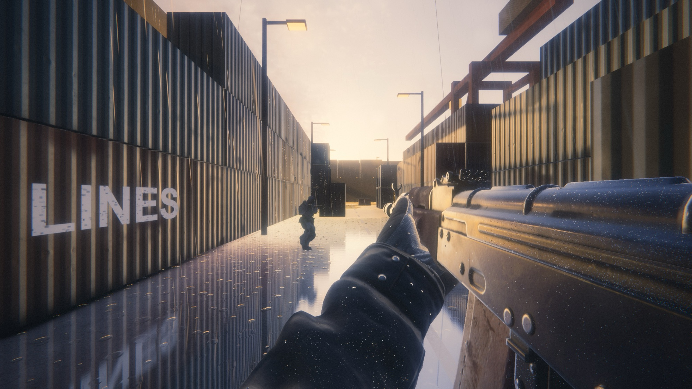
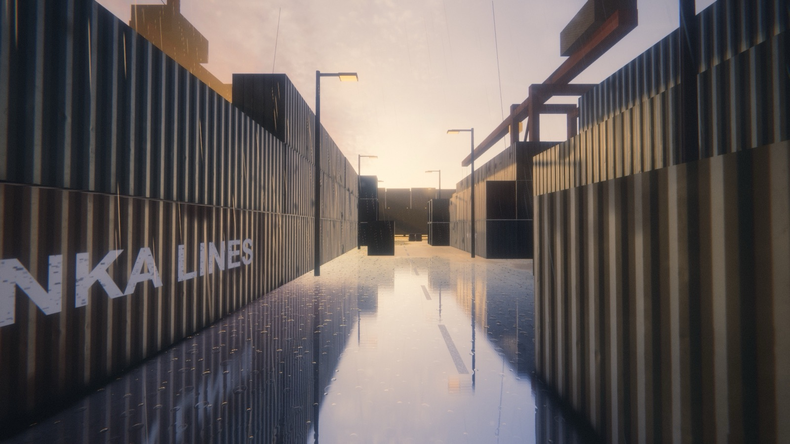
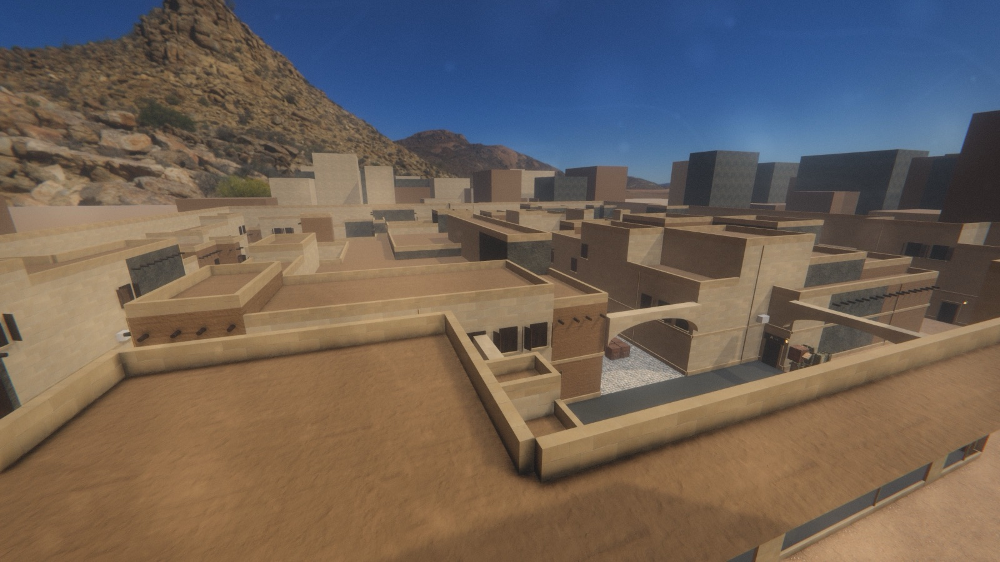
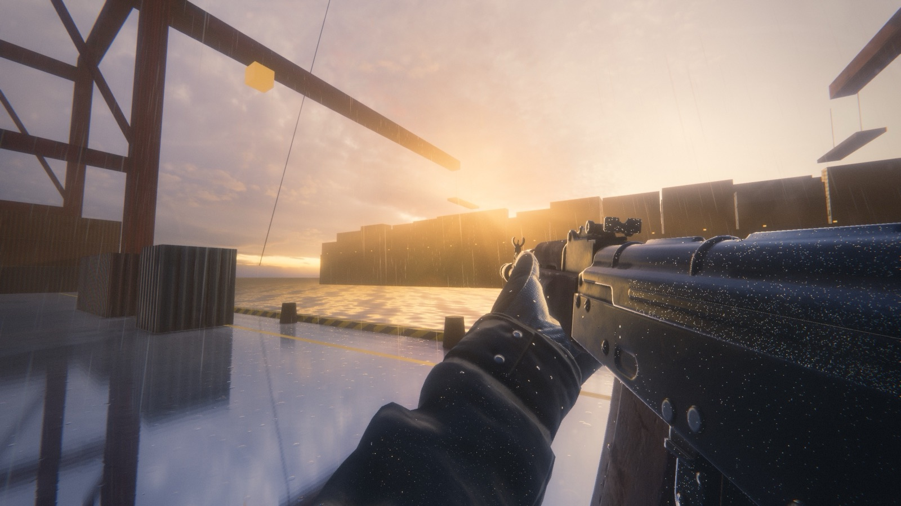
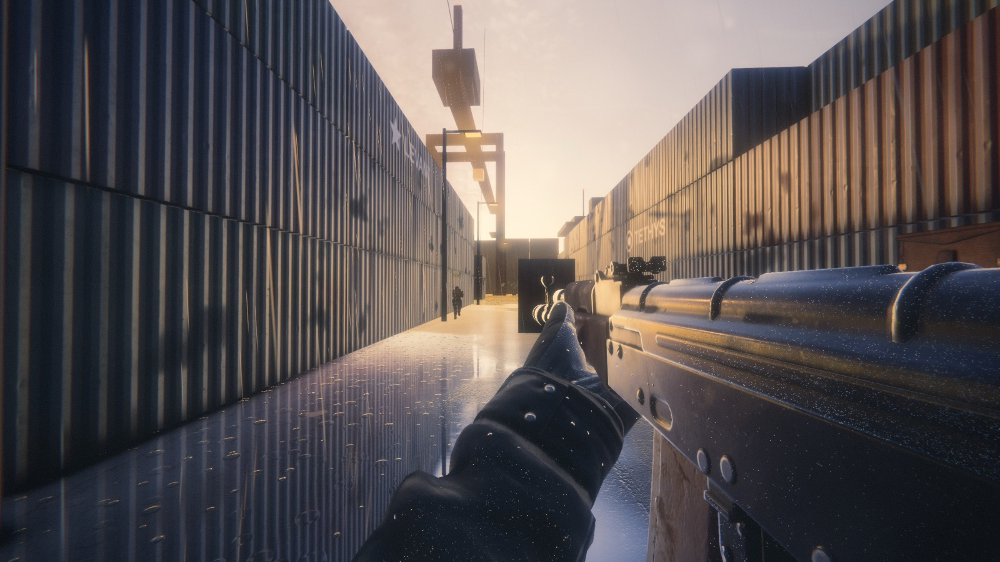
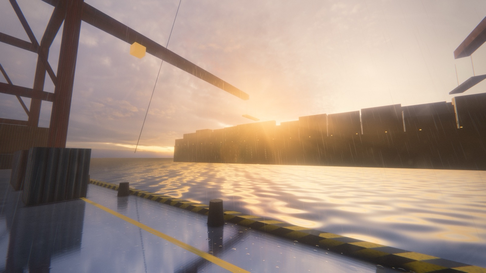
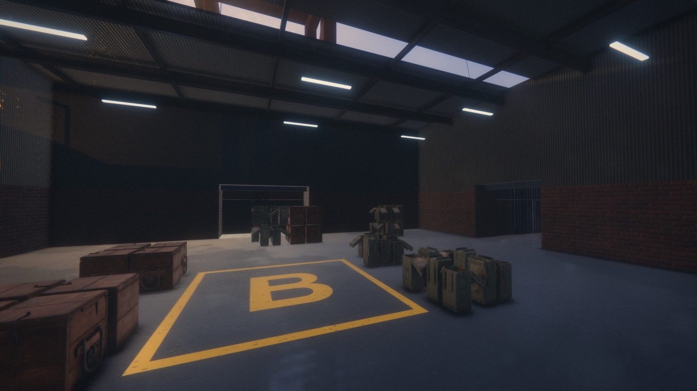
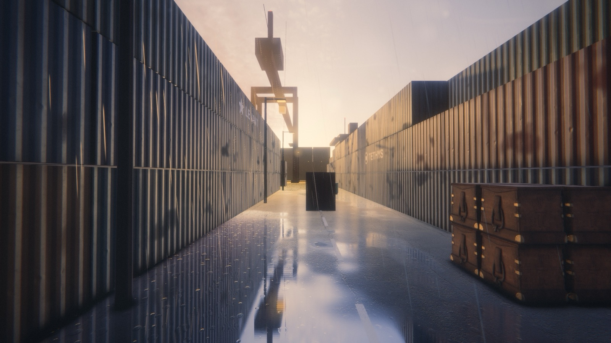
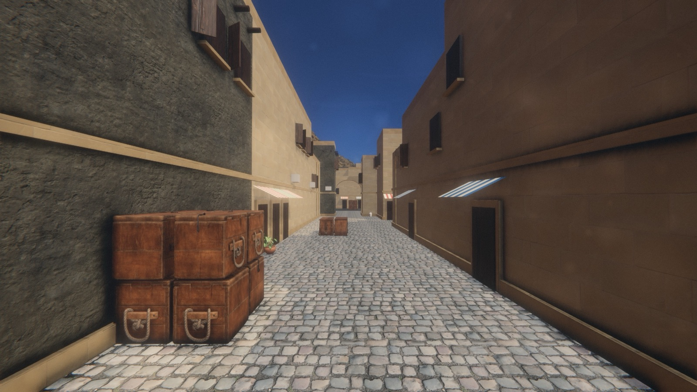
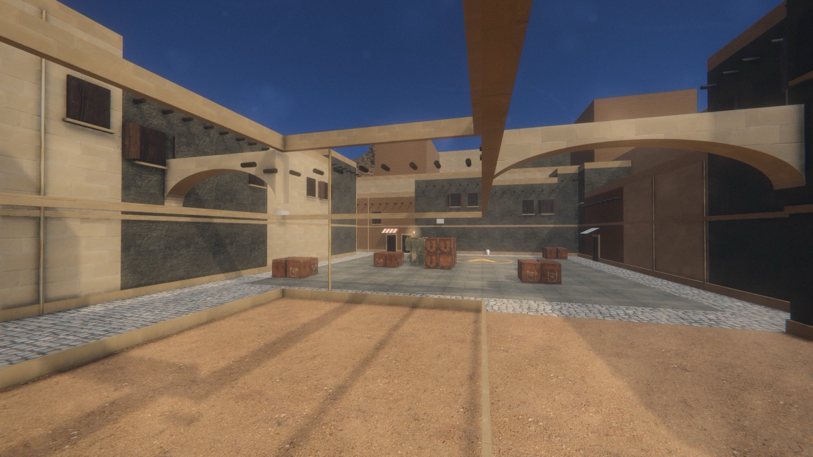

<p align="center">
  
</p>

<h1 align="center">KERVAN 5V5</h1>

<p align="center">
  <b>An open-source 5v5 tactical shooter that runs in your browser.</b><br>
  Bomb defusal · bots · round economy · two maps · hand-written GLSL render pipeline
</p>

<p align="center">
  <a href="https://artdzy.github.io/kervan-5v5/"><b>Project page</b></a> ·
  <a href="#quick-start">Quick start</a> ·
  <a href="#maps">Maps</a> ·
  <a href="#rendering">Rendering</a> ·
  <a href="#credits">Credits</a>
</p>

<p align="center">
  
  
  
  
</p>

---

One team plants the bomb, the other holds the site. Kervan 5v5 is a complete competitive shooter built from scratch for the web: an authoritative 30 Hz server with lag-compensated hit detection, bots that buy, rotate and defuse, and a cinematic post-processing pipeline written directly in GLSL. Players need nothing but a browser.

## Quick start

Requires **Node.js 18+** on the host.

```bash
git clone https://github.com/artdzy/kervan-5v5.git
cd kervan-5v5
npm install
npm start
```

Open `http://localhost:3000`. Friends on the same network can join through the LAN address the server prints on start.

### Play over the internet (free)

Expose your local server with a Cloudflare Quick Tunnel — no account or port forwarding needed.

```bash
brew install cloudflared   # once
npm start                  # terminal 1
npm run tunnel             # terminal 2
```

Share the `https://….trycloudflare.com` address it prints. The URL changes on every launch and stays up while your machine is running.

## Maps

Pick a map in the lobby; the first player to join a server decides the match map.

| **Liman** — rain-soaked container port | **Kervan** — sun-baked desert town |
|---|---|
|  |  |
| Wet asphalt with planar reflections and ripple rings, gantry cranes over site A, a sunlit warehouse at site B, a quay with a cargo ship, sunset backlight and lightning. | Sandstone and plaster buildings, arched passages, cobbled alleys and courtyards, windows and awnings under a hard midday HDRI sky. |

## Gameplay

- **Objective:** Attackers plant at site A or B (hold <kbd>E</kbd>, 3.2 s). Defenders defuse in 10 s, or 5 s with a kit. A planted bomb detonates after 40 s.
- **Rounds:** 5 s freeze time, 1:55 round timer. First to 13 wins; sides swap after round 12.
- **Economy:** $3250 for a win; loss bonus starts at $1400 and scales. Per-weapon kill rewards. Buy in spawn during the first 20 s.
- **Arsenal:** Knife, P9 Pistol, Magnum .50, SMG-9, Shotgun 12, AK Assault, M4 Carbine, Sniper .338 (scoped), Grenade. Gear: Kevlar, Helmet, Defuse Kit.
- **Bots:** Fill each team to five. They buy weapons, rotate through A, B and the tunnel with A* path-finding, plant and defuse.
- **Netcode:** Authoritative server at 30 Hz, client prediction, interpolated remote players and lag-compensated hit detection.

### Controls

| Key | Action |
|---|---|
| <kbd>W</kbd> <kbd>A</kbd> <kbd>S</kbd> <kbd>D</kbd> / Mouse | Move / aim |
| LMB / RMB | Fire / scope |
| <kbd>Space</kbd>, <kbd>Ctrl</kbd> or <kbd>C</kbd>, <kbd>Shift</kbd> | Jump, crouch, walk quietly |
| <kbd>R</kbd> | Reload |
| <kbd>1</kbd>–<kbd>5</kbd>, <kbd>Q</kbd>, wheel | Select weapon / last weapon |
| <kbd>E</kbd> (hold) | Plant / defuse |
| <kbd>B</kbd> / <kbd>L</kbd> | Buy menu / loadout |
| <kbd>Tab</kbd> | Scoreboard |
| <kbd>T</kbd> / <kbd>Enter</kbd> | Chat |

## Rendering



Instead of three.js's stock effects, every pass is hand-written GLSL (`client/js/render/`):

1. **HDR scene** — MSAA, depth texture, PBR materials, HDRI image-based lighting.
2. **SSAO** — half resolution, fades out on sunlit surfaces; bilateral upsample.
3. **Volumetric light** — ray-marched through the sun's shadow map with a two-lobe phase function; denser dust inside the warehouse.
4. **Wet world** — planar reflections with a mipped reflection texture, vertically stretched road reflections, puddle masks, ripple rings; GPU rain and splashes that stop under roofs and glow against the sun.
5. **Wet weapon** — model-space raindrops; the viewmodel is lit by the map's HDRI and loses sunlight when the player is in shadow.
6. **Bloom & lens** — six-level bloom with Karis average, eye adaptation with sun-occlusion test, lens dirt, ghosts, halo and starburst.
7. **Final grade** — ACES/AgX blend tone mapping, cool-shadow / warm-highlight grade, vignette, damage effect, film grain and dither.
8. **Pixel budget** — resolution is capped automatically on high-DPI screens.

**Quality presets** (lobby → *Graphics quality*): **Ultra** (reflections, volumetrics, SSAO, 4K shadows, MSAA), **High** (bloom, 2K shadows), **Low** (no post-processing). HDRI lighting, PBR materials and ACES tone mapping are on in every preset.

### Effects

- Bullet holes, surface-dependent dust puffs, stone and wood splinters, sparks on stone
- Blood mist and droplets, wall and floor splatter, a pool that grows under fallen players
- Ejected shell casings with ring-out sound, muzzle smoke, explosions and scorch marks
- Screen-edge blood on damage, desaturation and heartbeat at low health

## Gallery

| | |
|---|---|
|  |  |
|  |  |
|  |  |

All frames captured in real time in the browser on the Ultra preset.

## Project structure

```
server/   index.js (HTTP + WebSocket), game.js (rounds, hit detection, bomb, map selection), bot.js (bot AI)
shared/   constants.js, map.js (active map, collision, ray casting, A*), maps/ (kervan.js, liman.js), physics.js, util.js
client/   js/main.js, js/world.js, js/maps/ (common, kervan, liman), js/render/ (pipeline, reflection, weather),
          js/viewmodel.js, avatar.js, effects.js, audio.js, hud.js, assets/, dev/
tools/    fetch-polyhaven.mjs, import-models.mjs
docs/     project page (GitHub Pages)
```

### Developer pages

- `/dev/sheet.html?m=rifle&step=6` — weapon animation frames in a grid
- `/dev/sheet.html?m=all` — idle pose of every weapon
- `/dev/vm.html?m=rifle&t=6.8` — freezes the in-game viewmodel at a given clip time
- `/dev/avatar.html?view=side&w=rifle,pistol` — soldier model and weapon grip

### Re-downloading assets

```bash
node tools/fetch-polyhaven.mjs   # Poly Haven HDRIs, textures and models → client/assets/polyhaven/
npm run import-models            # Sketchfab .glb/.zip from ~/Downloads → client/assets/models/<weapon>/
```

Per-weapon camera alignment and animation frame ranges live in `client/assets/models/config.json`.

## Credits

- **First-person weapons (animated):** DJMaesen (@bumstrum) via the Sketchfab [High quality FPS assets collection](https://sketchfab.com/ahmettanju.2013/collections/high-quality-fps-assets-for-unity-fd68dd910c354c33ab8f8b1ad6d316f1), **CC BY 4.0**. Details in [`CREDITS.md`](CREDITS.md).
- **Environment:** [Poly Haven](https://polyhaven.com), **CC0**.
  - HDRIs: *Goegap* (Kervan), *Belfast Sunset (Pure Sky)* (Liman)
  - Textures: sandstone_blocks_08, plastered_stone_wall, clay_plaster, cobblestone_floor_08, gravelly_sand, large_floor_tiles_02, concrete_floor_worn_001, rough_wood, rusty_metal_02, asphalt_02, concrete_floor_02, container_side, corrugated_iron_02, rusty_painted_metal, red_brick_03, concrete_wall_008, painted_metal_shutter, metal_plate
  - Models: wooden_crate_01/02, old_military_crate, Barrel_01, wooden_barrels_01, planter_pot_clay, ceramic_vase_02, potted_plant_02, concrete_road_barrier_02, utility_box_02, small_lpg_tank
- **Soldier:** `Soldier.glb` from the three.js examples (Mixamo character).

## License

Source code is released under the [MIT license](package.json). Third-party assets keep their own licenses listed above.
